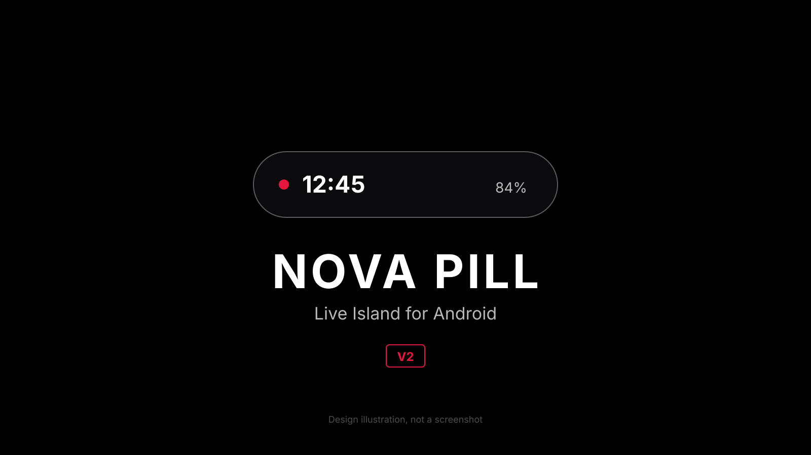
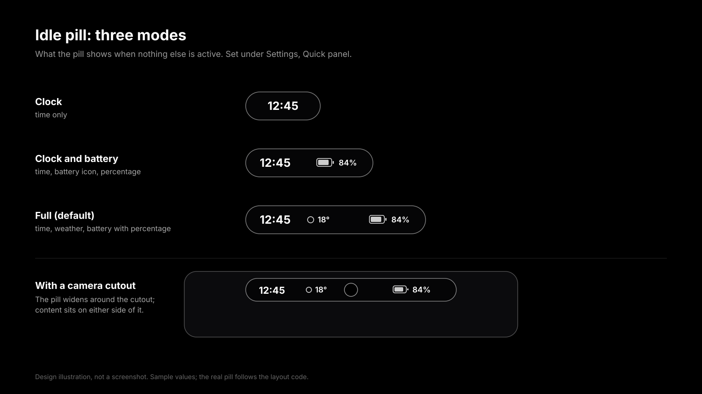
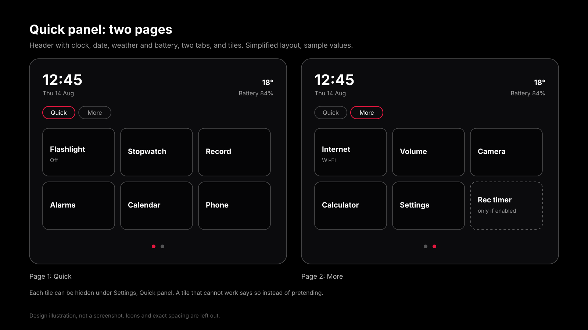
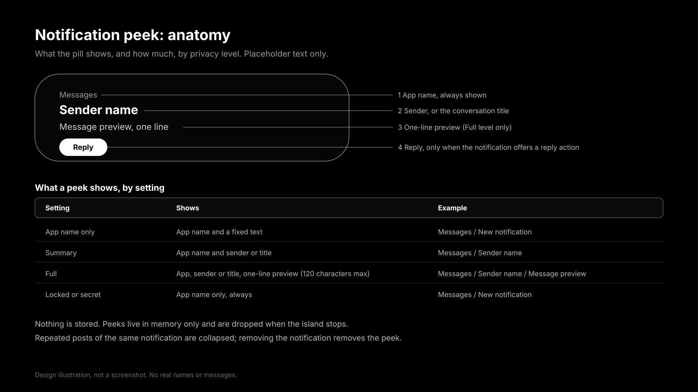
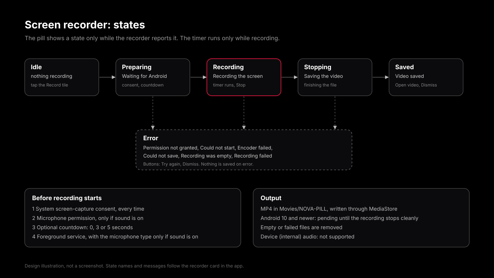
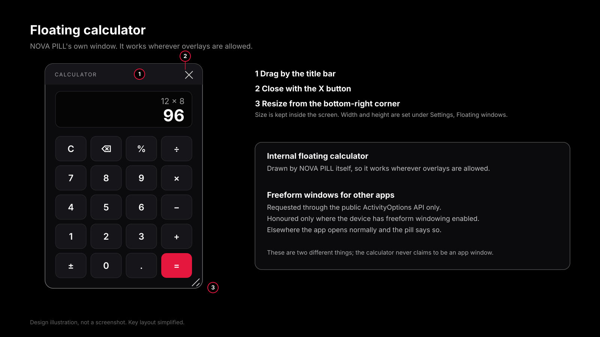
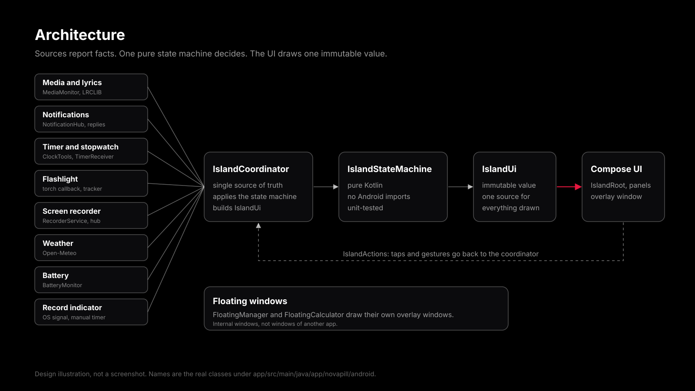
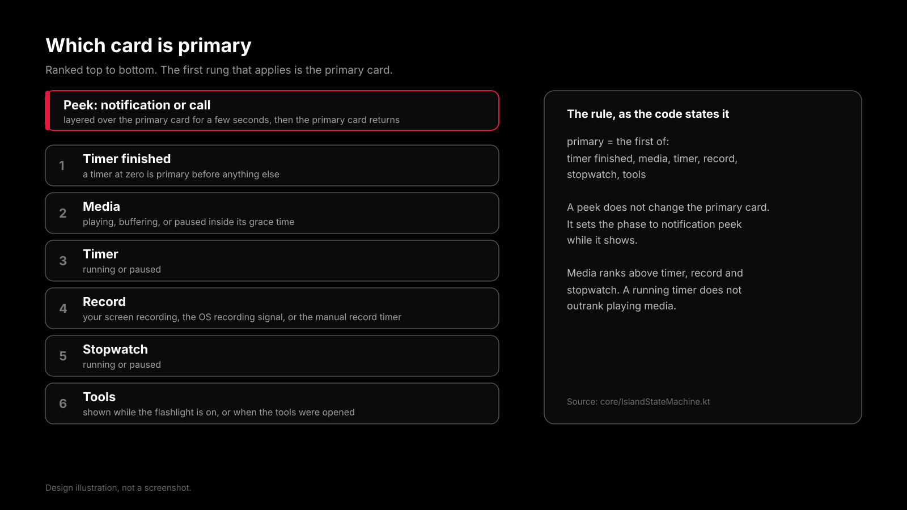
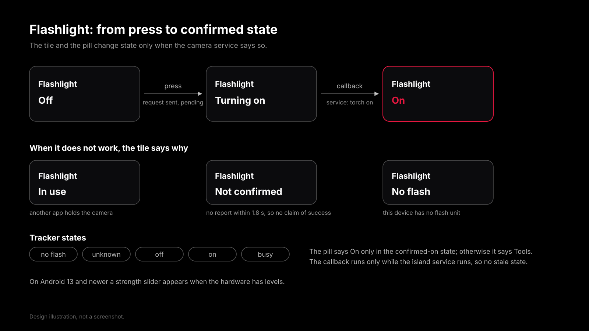

<p align="center">
  
</p>

<h1 align="center">NOVA PILL — Live Island</h1>

<p align="center">
Pil bergaya Dynamic Island untuk Android. Tampil di bagian atas layar dan menampilkan musik, timer, panggilan, notifikasi, senter, dan perekam layar. Native Kotlin dan Jetpack Compose.
</p>

> **Versi 2.0.0.** Seluruh proyek berhasil di-build di GitHub Actions: APK debug jadi dan unit test lulus. Aplikasi belum dijalankan di HP sungguhan, jadi fitur yang butuh perangkat masih berstatus menunggu uji. Tabel [Status](#status) menjelaskan apa yang sudah terverifikasi dan apa yang belum. Versi Inggris: [README.md](README.md).

## Isi

[Yang baru di 2.0.0](#yang-baru-di-200) · [Tur fitur](#tur-fitur) · [Cara kerja](#cara-kerja) · [Prioritas kartu](#prioritas-kartu) · [Bug senter](#bug-senter-dan-perbaikannya) · [Peta pengaturan](#peta-pengaturan) · [Izin](#izin) · [Build di GitHub](#build-di-github) · [Pasang](#pasang-dan-pemakaian-pertama) · [Pengujian](#pengujian) · [Status](#status) · [Batasan](#batasan) · [Privasi](#privasi) · [Struktur proyek](#struktur-proyek)

## Yang baru di 2.0.0

- **Senter menampilkan keadaan sebenarnya.** Tile dan pil ringkas mengikuti status senter dari layanan kamera, bukan tebakan yang disimpan. Pil menulis "On" hanya saat senter terkonfirmasi menyala.
- **Panel idle yang nyata.** Jam, tanggal, cuaca (Open-Meteo), dan baterai dengan persen, dalam tiga mode idle.
- **Panel cepat dua halaman.** Dua belas tile, masing-masing bisa disembunyikan. Tile yang tidak bisa jalan di perangkat ini memberi tahu, bukan pura-pura bekerja.
- **Notifikasi yang menunjukkan siapa dan apa.** Nama aplikasi, pengirim, pratinjau satu baris, tiga tingkat privasi, dan tombol balas bila notifikasinya menyediakan.
- **Perekam layar** berbasis MediaProjection. Hasilnya MP4 di `Movies/NOVA-PILL`.
- **Jendela mengambang.** Aplikasi bisa dibuka dengan ukuran freeform bila perangkat mengizinkan. Kalkulator adalah jendela mengambang internal yang bisa digeser, diubah ukurannya, dan ditutup.
- **Lebih banyak pengaturan.** Bagian baru *Quick panel*, *Screen recorder*, dan *Floating windows*, plus opsi baru di bagian lama.
- **Tulisan "V2" di layar intro**, plus kartu What's new satu kali. Versi 2.0.0; pengaturan dari 1.0 dimigrasikan otomatis.

## Tur fitur

<p align="center"></p>
<p align="center"><sub>Ilustrasi desain, bukan screenshot.</sub></p>

**Idle.** Jam saja, jam + baterai, atau baris penuh: jam, cuaca, dan persen baterai (bawaan). Di HP dengan cutout kamera, pil melebar di sekeliling cutout. Cuaca dari Open-Meteo dengan status memuat, offline, dan basi yang eksplisit, lengkap dengan sumber dan waktu pembaruan. Satuan suhu bisa mengikuti perangkat atau dikunci ke Celsius/Fahrenheit.

<p align="center"></p>

**Panel cepat.** Dua belas tile di dua halaman: Flashlight, Stopwatch, Record, Alarms, Calendar, Phone, Internet, Volume, Camera, Calculator, Settings, dan Manual timer. Tiap tile bisa disembunyikan di *Settings, Quick panel*. Bila suatu aksi tidak tersedia (tidak ada flash, tidak ada izin, tidak ada aplikasi pengelola), tile menampilkan pemberitahuan singkat.

<p align="center"></p>

**Notifikasi.** Pil menampilkan nama aplikasi, pengirim (atau judul percakapan), dan pratinjau satu baris. Tiga tingkat privasi: hanya nama aplikasi; aplikasi + pengirim/judul; ditambah pratinjau satu baris (maks. 120 karakter). Notifikasi rahasia atau yang masuk saat perangkat terkunci selalu hanya menampilkan nama aplikasi. Notifikasi yang sama tidak diulang, dan peek hilang saat notifikasinya dihapus. Tombol **Balas** muncul hanya bila notifikasi punya aksi balas (`RemoteInput`) dan opsinya aktif. Isi pesan hanya ada di memori selama peek tampil: tidak disimpan, tidak di-log, tidak diunggah.

<p align="center"></p>

**Perekam layar.** Memakai MediaProjection; Android meminta persetujuan setiap kali, begitu juga aplikasi. Setelah itu foreground service memegang rekaman sehingga tetap jalan saat kamu keluar dari aplikasi. Status: Idle, Preparing, Recording, Stopping, Saved, Error; timer di pil hanya berjalan saat perekam benar-benar merekam. Opsi: 720p/1080p, 30/60 fps, mikrofon, hitung mundur 0/3/5 detik, dan sembunyikan pil saat merekam. Hasil: MP4 di `Movies/NOVA-PILL` lewat MediaStore. **Audio internal tidak didukung**; hanya mikrofon.

<p align="center"></p>

**Jendela mengambang.** Dua hal yang berbeda: (1) *freeform untuk aplikasi lain*: shortcut meminta Android membuka aplikasi dengan batas freeform lewat API publik `ActivityOptions`; hanya berhasil di perangkat yang mendukung dan mengaktifkan freeform, selain itu aplikasi dibuka biasa dan pil memberi tahu. (2) *kalkulator mengambang internal*: jendela yang digambar NOVA PILL sendiri, bisa digeser lewat bar, diubah ukuran dari sudut, ditutup dengan tombol X.

**Dari 1.0.** Pemutar musik dengan lirik tersinkron (LRCLIB atau impor `.lrc`) dan visualizer, timer, stopwatch, peek panggilan, peek notifikasi dengan filter per aplikasi, layout landscape, pemilih aplikasi.

## Cara kerja

<p align="center"></p>

- **`core/`**: Kotlin murni tanpa import Android (state machine, matematika timer, torch tracker, state machine perekam, kalkulator, geometri jendela). Bagian inilah yang diuji unit test.
- **`settings/` dan `data/`**: satu objek `NovaSettings` imutabel dengan codec berversi (skema 2; skema 1 dimigrasikan saat dibaca), disimpan di DataStore.
- **Sumber**: sesi media, notification listener, timer/stopwatch, callback senter kamera, layanan perekam, baterai, cuaca.
- **`IslandCoordinator`**: satu sumber kebenaran; menerapkan state machine, membangun `IslandUi` imutabel, dan menyediakan `IslandActions`.
- **`overlay/ui/`**: UI Compose yang hanya merender `IslandUi`. Ukuran jendela dihitung `IslandLayout`, fungsi yang sama dipakai UI.

## Prioritas kartu

<p align="center"></p>

Urutan pemenang: **timer selesai, media, timer, record, stopwatch, tools**. Kartu tools tampil saat senter menyala atau tools dibuka. Notifikasi dan panggilan adalah peek: mengambil pil beberapa detik lalu kartu aktif kembali.

## Bug senter dan perbaikannya

<p align="center"></p>

**Gejala (1.0):** pil menulis senter menyala padahal tidak ditekan. **Penyebab:** kartu tools ringkas menulis "On" tetap setiap kali tampil, dan panel memakai boolean tersimpan, bukan bertanya ke layanan kamera. **Perbaikan (2.0):**

- Status dilacak per kamera yang punya flash: *no flash, unknown, off, on, busy*.
- Tekan tombol = kirim permintaan dan tandai *pending*; status berubah ke On/Off hanya saat layanan kamera melaporkannya.
- Bila tidak ada laporan dalam 1,8 detik, tile menampilkan "tidak terkonfirmasi", bukan mengaku berhasil.
- Bila kamera dipakai aplikasi lain, penolakan ditampilkan sebagai "busy".
- Callback hanya terdaftar selama layanan island berjalan dan dilepas saat berhenti.
- Android 13+: slider kekuatan bila hardware mendukung.
- Pil ringkas menulis "On" hanya bila senter terkonfirmasi menyala; selain itu "Tools".

## Peta pengaturan

General, Appearance, Behavior, Notifications, Music, **Quick panel**, **Screen recorder**, Record indicator, **Floating windows**, Landscape, Utilities, Privacy & Permissions, About & Debug. Tiga yang tebal baru di 2.0.

## Izin

| Izin | Fungsi | Bila ditolak |
|---|---|---|
| Tampil di atas aplikasi lain | Menggambar pil dan jendela mengambang | Pil tidak bisa tampil |
| Akses notifikasi | Peek notifikasi dan media | Tidak ada peek notifikasi; sisanya jalan |
| Posting notifikasi (Android 13+) | Notifikasi layanan, timer, rekaman | Notifikasi layanan disembunyikan sistem |
| Foreground service (`specialUse`, `mediaProjection`, `microphone`) | Menjaga island hidup; merekam layar/suara | Rekaman tidak bisa mulai |
| Rekam audio | Mikrofon di rekaman | Rekaman tanpa suara |
| Lokasi perkiraan | Cuaca lokal (opsional) | Cuaca tampil tidak tersedia |
| Internet dan status jaringan | Cuaca, lirik, tile Internet | Fitur itu tampil offline |
| Receive boot completed | Memulihkan island setelah restart | Dijalankan manual |
| Detect screen recording (Android 15+) | Sinyal rekam layar milik Android | Timer manual tetap jalan |

## Build di GitHub

1. Buat repositori dan push proyek ini.
2. Buka tab **Actions**, workflow **Android build**: JDK 17, Android SDK, Gradle, lalu `./gradlew --no-daemon --stacktrace :app:assembleDebug` dan mengunggah artifact **`nova-pill-debug-apk`**. Bila run tidak mulai sendiri setelah push, jalankan dari tab Actions.
3. Langkah berikutnya menjalankan unit test (`:app:testDebugUnitTest`).
4. Unduh artifact dari halaman run. Tidak ada keystore atau secret di repositori; APK ditandatangani debug.

Terakhir diverifikasi: run #3 pada commit `bda8a5a` (2026-11-27). APK jadi, unit test lulus, dan laporan lint terunggah. Run #1 dan #2 gagal; kegagalan itu menjadi alasan dua perbaikan build yang tercatat di [changelog](CHANGELOG.md).

Build lokal: JDK 17 + Android SDK (API 36), buka folder di Android Studio atau `./gradlew :app:assembleDebug`.

## Pasang dan pemakaian pertama

1. Ekstrak artifact, pasang `.apk` (izinkan pemasangan dari sumber ini).
2. Buka aplikasi; wizard menjelaskan tiap izin.
3. Beri *Tampil di atas aplikasi lain* dulu, lalu *Akses notifikasi* bila ingin peek.
4. Bila pil hilang di HP yang agresif mematikan aplikasi latar, kecualikan NOVA PILL dari optimasi baterai.

## Pengujian

- **Sudah dijalankan lokal:** 188 unit test pada logika tanpa Android (kompilasi `kotlinc` 2.0.21 + JUnit): codec pengaturan dan migrasi, state machine, layout, torch tracker, state machine perekam, kalkulator, geometri jendela, teks/filter/dedup notifikasi, parser lirik, matematika timer, JSON helper, kode cuaca, rute pengaturan.
- **Terverifikasi di GitHub Actions (run #3, 2026-11-27):** `:app:assembleDebug` mengompilasi seluruh lapisan Android dan menghasilkan APK debug; `:app:testDebugUnitTest` menjalankan unit test. Keduanya sukses. Android Lint juga jalan dan laporannya diunggah sebagai artifact.
- **Belum diuji:** semua yang butuh runtime Android (overlay, torch kamera, MediaProjection, MediaStore, notification listener, DataStore, UI Compose). Build hijau hanya membuktikan kode bisa dikompilasi dan dikemas, bukan bahwa perilakunya benar di HP; bagian itu perlu kamu pastikan lewat checklist.
- Daftar uji di perangkat: [`docs/MANUAL_TEST_CHECKLIST.md`](docs/MANUAL_TEST_CHECKLIST.md). Laporan lengkap: [`docs/V2_REPORT.md`](docs/V2_REPORT.md).

## Status

Label: **DONE & VERIFIED**, **IMPLEMENTED, DEVICE TEST PENDING**, **PARTIALLY IMPLEMENTED**, **NOT SUPPORTED**, **NOT IMPLEMENTED**.

| Area | Status |
|---|---|
| Build Gradle seluruh aplikasi + unit test di GitHub Actions | DONE & VERIFIED (run #3, commit `bda8a5a`) |
| State machine pulau dan prioritas kartu | DONE & VERIFIED (logika saja) |
| Codec pengaturan dan migrasi 1.0 ke 2.0 | DONE & VERIFIED (logika saja) |
| Senter mengikuti status torch asli | IMPLEMENTED, DEVICE TEST PENDING |
| Slider kekuatan senter (Android 13+) | IMPLEMENTED, DEVICE TEST PENDING |
| Idle: jam, tanggal, baterai | IMPLEMENTED, DEVICE TEST PENDING |
| Idle: cuaca (Open-Meteo) | IMPLEMENTED, DEVICE TEST PENDING |
| Panel cepat: 2 halaman, 12 tile | IMPLEMENTED, DEVICE TEST PENDING |
| Peek notifikasi: aplikasi, pengirim, pratinjau | IMPLEMENTED, DEVICE TEST PENDING |
| Balas dari peek | PARTIALLY IMPLEMENTED (hanya bila notifikasi punya aksi balas) |
| Perekam layar (video ke `Movies/NOVA-PILL`) | IMPLEMENTED, DEVICE TEST PENDING |
| Mikrofon perekam | IMPLEMENTED, DEVICE TEST PENDING |
| Audio internal perekam | NOT SUPPORTED |
| Freeform untuk aplikasi lain | PARTIALLY IMPLEMENTED (API publik, tergantung perangkat) |
| Kalkulator mengambang internal | IMPLEMENTED, DEVICE TEST PENDING |
| Layar pengaturan, 13 bagian | IMPLEMENTED, DEVICE TEST PENDING |
| Fitur dari 1.0 | IMPLEMENTED, DEVICE TEST PENDING (uji ulang setelah 2.0) |

## Batasan

- Overlay tidak bisa menggambar di atas sebagian layar sistem (misalnya layar kunci di banyak perangkat, dialog aman, prompt izin).
- Konten terlindungi (aplikasi yang memblokir screenshot, video DRM) terekam hitam. Itu aturan Android.
- Tidak ada audio perangkat di rekaman.
- Freeform tergantung perangkat; bila tidak ada, aplikasi dibuka biasa.
- Balas dari peek hanya bila aplikasi lain menyediakan aksi balas.
- Android 8 dan 9: rekaman disimpan di folder Movies milik aplikasi, bukan folder galeri bersama.
- Sebagian produsen membatasi overlay dan layanan latar lebih dari yang diwajibkan Android.

## Privasi

Tanpa akun, analitik, iklan, atau crash reporting. Isi notifikasi hanya dibaca untuk menampilkan peek, tetap di memori, tidak disimpan/di-log/dikirim. Permintaan jaringan: cuaca (koordinat perkiraan ke Open-Meteo) dan lirik (judul, artis, durasi ke LRCLIB). Rekaman layar hanya tersimpan di perangkat.

## Struktur proyek

```
app/src/main/java/app/novapill/android/
  core/ settings/ data/ overlay/ overlay/ui/ media/ lyrics/ notif/ record/ service/ perm/ util/ ui/
app/src/test/      unit test untuk logika
docs/              checklist uji manual, laporan V2, gambar (sumber SVG di docs/images/src)
.github/workflows/android-build.yml
```

Penjelasan tiap folder ada di [README.md](README.md#project-layout).

## Lisensi dan kredit

Belum ada lisensi; tambahkan file `LICENSE` sebelum repositori dibuat publik. Kredit: Open-Meteo (cuaca), LRCLIB (lirik), Shizuku (integrasi opsional), Kotlin, AndroidX, Jetpack Compose, OkHttp, kotlinx.coroutines.
