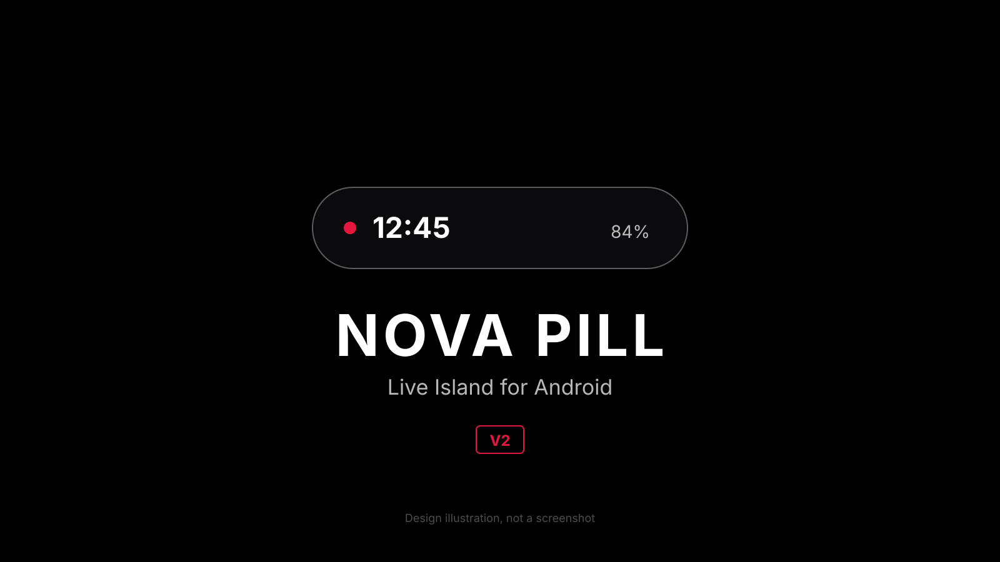
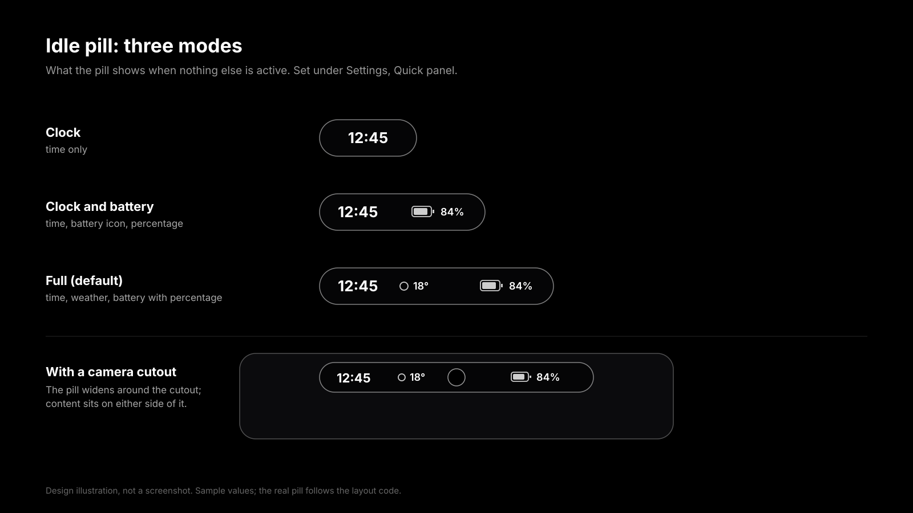
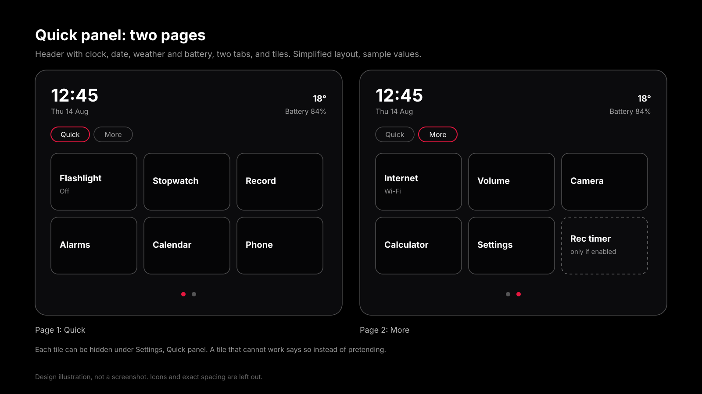
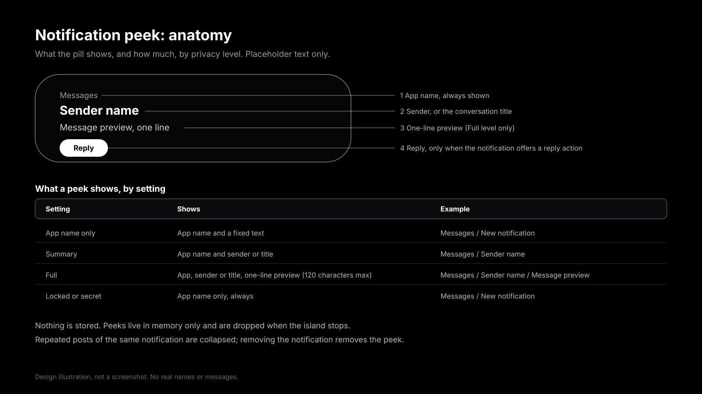
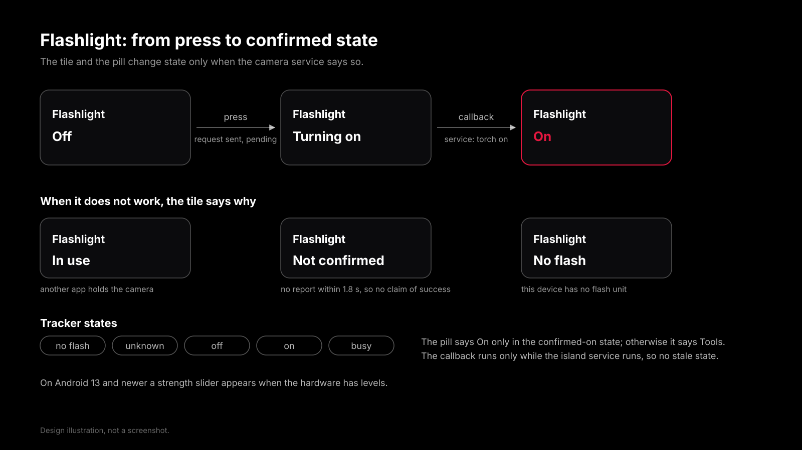
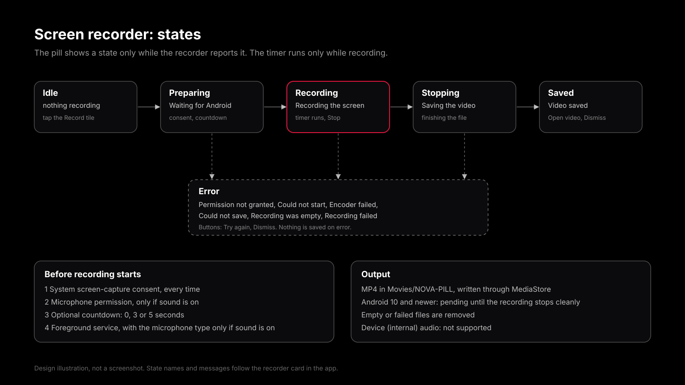
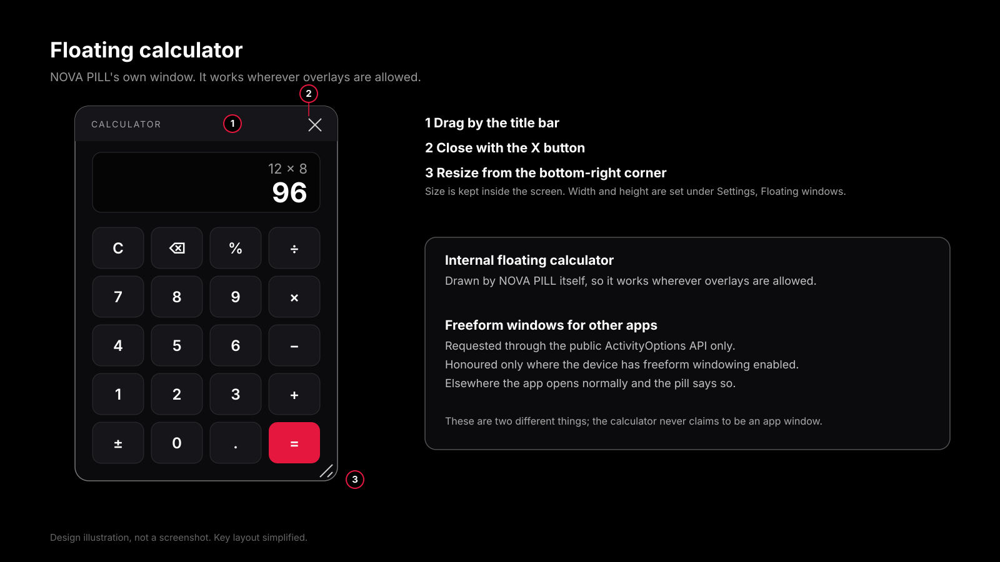
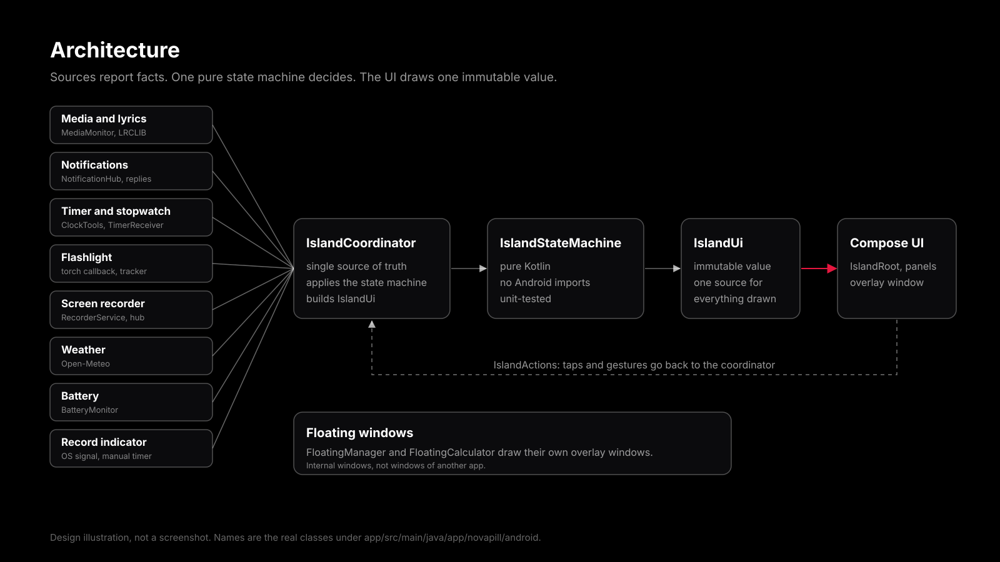
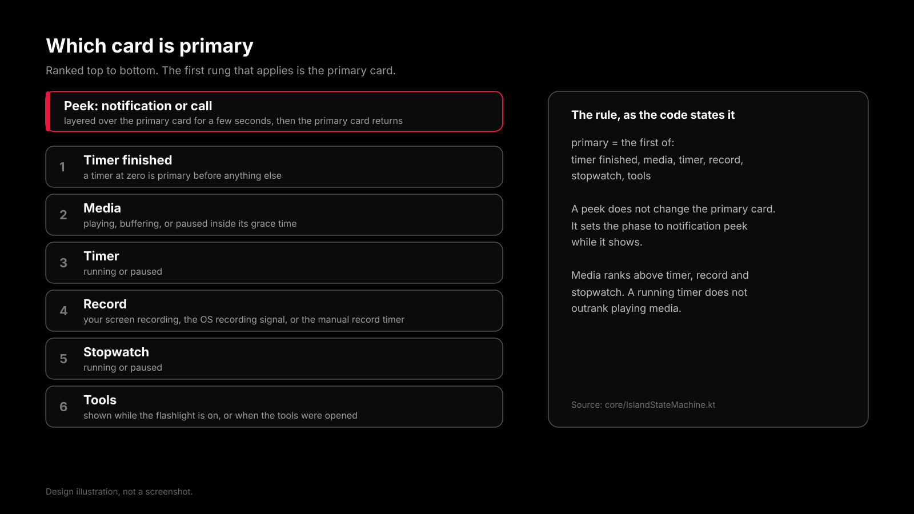

<p align="center">
  
</p>

<h1 align="center">NOVA PILL — Live Island</h1>

<p align="center">
A Dynamic-Island-style pill for Android. It sits at the top of the screen and shows music, timers, calls, notifications, a flashlight and a screen recorder. Native Kotlin and Jetpack Compose.
</p>

<p align="center">
  
  
  
  
  
</p>

> **Version 2.0.0.** The logic layer has 188 passing unit tests. The Android layer is written and statically checked, but it has not been through a full Gradle build or a run on a real phone yet. The [Status](#status) table says exactly what is verified and what is not. Indonesian version: [README.id.md](README.id.md).

## Contents

- [What's new in 2.0.0](#whats-new-in-200)
- [Feature tour](#feature-tour)
- [How it works](#how-it-works)
- [Card priority](#card-priority)
- [The flashlight bug and the fix](#the-flashlight-bug-and-the-fix)
- [Settings map](#settings-map)
- [Permissions](#permissions)
- [Build on GitHub](#build-on-github)
- [Install and first run](#install-and-first-run)
- [Testing](#testing)
- [Status](#status)
- [Known limits](#known-limits)
- [Privacy](#privacy)
- [Project layout](#project-layout)
- [Roadmap](#roadmap)
- [License](#license) and [Credits](#credits)

## What's new in 2.0.0

- **The flashlight tells the truth.** The tile and the compact pill follow the torch state reported by the camera service instead of a stored guess. The pill says "On" only when the torch is confirmed on. ([details](#the-flashlight-bug-and-the-fix))
- **A real idle panel.** Clock, date, weather (Open-Meteo) and battery with percentage, in three idle modes.
- **A two-page quick panel.** Twelve tiles, each can be hidden. A tile that cannot work on this device says so instead of pretending.
- **Notification peeks that say who and what.** App name, sender, a one-line preview, three privacy levels, and a reply button when the notification offers one.
- **A screen recorder** built on MediaProjection. It saves an MP4 to `Movies/NOVA-PILL`.
- **Floating windows.** Apps can be launched with freeform bounds where the device allows it. The calculator is an internal floating window you can drag, resize and close.
- **More settings.** New sections *Quick panel*, *Screen recorder* and *Floating windows*, and new options in the existing ones.
- **"V2" on the intro screen**, plus a one-time What's new card. Version 2.0.0, settings schema 2; settings saved by 1.0 migrate automatically.

## Feature tour

### Idle: clock, weather, battery

<p align="center"></p>
<p align="center"><sub>Design illustration, not a screenshot. The three idle modes.</sub></p>

The idle pill shows the clock only, clock and battery, or the full row of time, weather and battery percentage (the default). On a phone with a camera cutout the pill widens around the cutout instead of covering it. Weather comes from Open-Meteo. The panel has explicit loading, offline and stale states and shows where the data came from and when it was last updated. The temperature unit follows the device or can be fixed to Celsius or Fahrenheit.

### Quick panel

<p align="center"></p>
<p align="center"><sub>Design illustration, not a screenshot. Header, tiles, page dots.</sub></p>

Twelve tiles over two pages: Flashlight, Stopwatch, Record, Alarms, Calendar, Phone, Internet, Volume, Camera, Calculator, Settings and Manual timer. The header shows clock, date, weather and battery. Each tile can be hidden under *Settings, Quick panel*. When an action is not available (no flash unit, no permission, no app to handle it) the tile shows a short notice instead of acting as if it worked.

### Notifications

<p align="center"></p>
<p align="center"><sub>Design illustration, not a screenshot. The sample text is placeholder text.</sub></p>

When a notification arrives the pill peeks with the app name, the sender (or conversation title) and a one-line preview. Three privacy levels decide how much is shown: app name only; app name plus sender or title; and additionally a one-line preview capped at 120 characters. Notifications that are marked secret, or that arrive while the device is locked, always show the app name only. Repeated posts of the same notification are collapsed, and the peek goes away when the notification is removed.

A **Reply** button appears only when the notification carries a reply action (a `RemoteInput`) and the option is on. It opens a small input and sends through the app's own action. If the app offers no reply action there is no button.

Message text is held in memory while the peek is on screen. It is not written to disk, not logged and not uploaded.

### Flashlight

<p align="center"></p>
<p align="center"><sub>Design illustration, not a screenshot. How a press becomes a confirmed state.</sub></p>

See [The flashlight bug and the fix](#the-flashlight-bug-and-the-fix).

### Screen recorder

<p align="center"></p>
<p align="center"><sub>Design illustration, not a screenshot. Recorder states.</sub></p>

The recorder uses Android's MediaProjection. Android asks for screen-capture consent every time, and so does the app. After consent a foreground service owns the recording, so it keeps running when you leave the app. The service type is `mediaProjection`, plus `microphone` only when sound is switched on and the microphone permission is granted.

- **States:** Idle, Preparing, Recording, Stopping, Saved, Error. The timer on the pill runs only while the recorder reports that it is really recording.
- **Options** (*Settings, Screen recorder*): 720p or 1080p, 30 or 60 fps, microphone on or off, countdown of 0, 3 or 5 seconds, and hiding the pill while recording.
- **Output:** an MP4 in `Movies/NOVA-PILL`, written through MediaStore. On Android 10 and newer the file stays marked pending until the recording stops cleanly, and empty or failed files are removed. On Android 8 and 9 the file goes to the app's Movies folder and the pill says so instead of offering a viewer.
- **Internal (device) audio is not supported.** Only the microphone can be recorded.

### Floating windows

<p align="center"></p>
<p align="center"><sub>Design illustration, not a screenshot. Drag handle, resize corner, close button.</sub></p>

Two different things, kept honest:

- **Freeform windows for other apps.** The app shortcuts can ask Android to open an app with freeform bounds, using the public `ActivityOptions` API only. This works on devices where freeform windowing is available and enabled. Elsewhere the app opens normally and the pill says that freeform was not available. Nothing here uses hidden APIs.
- **An internal floating calculator.** A window drawn by NOVA PILL itself, so it works on any device that allows overlays. Drag it by the bar, resize it from the corner, close it with the X button. Size is set in *Settings, Floating windows*.

### Carried over from 1.0

Music player with synced lyrics (LRCLIB lookup, or import your own `.lrc`) and an audio visualizer; timer and stopwatch; call peeks; notification peeks with per-app filters; a landscape layout with its own position and size; an app picker; appearance, motion and behavior settings.

## How it works

<p align="center"></p>
<p align="center"><sub>Design illustration. Data flows left to right; user actions flow back.</sub></p>

The code is split so that everything testable without a phone is tested without a phone.

- **`core/`** is plain Kotlin with no Android imports: the island state machine (which card wins), timer math, the torch tracker, the recorder state machine, the calculator engine, floating-window geometry, the peek queue and timer, storage formatting. This is the part the unit tests cover.
- **`settings/` and `data/`** hold one immutable `NovaSettings` object, written with a versioned codec (schema 2, schema 1 migrates on read) and stored with DataStore.
- **Sources** are media sessions, the notification listener, timer and stopwatch, the camera torch callback, the recorder service, battery and weather. Each reports plain state into the coordinator.
- **`IslandCoordinator`** owns the single source of truth. It applies the state machine, builds an immutable `IslandUi` and exposes `IslandActions` for everything the user can do.
- **`overlay/ui/`** is Compose UI that only renders `IslandUi` and calls `IslandActions`. It draws into a `TYPE_APPLICATION_OVERLAY` window. The window size comes from `IslandLayout`, the same function the UI uses to lay itself out, so window and content cannot drift apart.

## Card priority

<p align="center"></p>
<p align="center"><sub>Design illustration.</sub></p>

When several things want the pill at once, one card wins, in this order: **timer finished, media, timer, record, stopwatch, tools**. The tools card shows while the flashlight is on or the tools were opened. Notifications and calls are peeks: they take the pill for a few seconds and then the active card comes back.

## The flashlight bug and the fix

**Symptom (1.0):** the pill said the flashlight was on although it had never been pressed.

**Cause:** two things. The compact tools card printed a fixed "On" whenever it was visible, and the panel relied on a stored boolean instead of asking the camera service.

**Fix (2.0):**

- Torch state is tracked per camera that has a flash unit. The tracker has five states: *no flash, unknown, off, on, busy*.
- A press sends a request and marks it *pending*. The state changes to On or Off only when the camera service reports it.
- If nothing is reported within 1.8 seconds, the tile shows a "not confirmed" notice instead of claiming success.
- If another app is using the camera, the refusal is shown as such ("busy"), not hidden.
- The torch callback is registered only while the island service runs and is released when it stops, so the panel never shows stale state from a previous run.
- On Android 13 and newer, a strength slider appears when the hardware supports levels.
- The compact pill says "On" only when the torch is confirmed on; otherwise it says "Tools".

The tracker is plain Kotlin and is unit-tested. The camera calls themselves still need a device test.

## Settings map

| Section | What it controls |
|---|---|
| General | Start-up and reset |
| Appearance | Size, position, shape, motion feel |
| Behavior | Gestures, idle, hiding |
| Notifications | Peeks, filters, privacy |
| Music | Player, lyrics, visualizer |
| Quick panel | Idle pill, flashlight, tiles |
| Screen recorder | Quality, sound, countdown |
| Record indicator | Android's signal and manual timer |
| Floating windows | Calculator and app windows |
| Landscape | Position and size when rotated |
| Utilities | Clock, timer, weather, shortcuts |
| Privacy & Permissions | What is read, what is stored |
| About & Debug | Versions, state, diagnostics |

## Permissions

| Permission or access | Used for | If denied |
|---|---|---|
| Display over other apps (`SYSTEM_ALERT_WINDOW`) | Drawing the pill and the floating windows | The pill cannot be shown |
| Notification access (listener) | Notification and media peeks | No notification peeks; the rest works |
| Post notifications (Android 13+) | The foreground-service, timer and recording notifications | The service notification is hidden by the system |
| Foreground service (`specialUse`, `mediaProjection`, `microphone`) | Keeping the island alive; recording the screen; recording sound | Recording cannot start without its service type |
| Record audio | Microphone in recordings, asked when you start a recording with sound on | The recording is made without sound |
| Approximate location | Local weather (optional) | Weather shows an unavailable state |
| Internet and network state | Weather, lyrics lookup, the Internet tile | Those features show an offline state |
| Receive boot completed | Restoring the island after a restart | You start it manually |
| Detect screen recording (Android 15+) | Android's own recording signal for the record indicator | The manual timer still works |

The system's screen-capture consent is separate and is asked each time you record.

## Build on GitHub

1. Create a repository and push this project to it.
2. Open the **Actions** tab and the workflow **Android build**. It sets up JDK 17, the Android SDK and Gradle, runs `./gradlew --no-daemon --stacktrace :app:assembleDebug`, and uploads the debug APK as the artifact **`nova-pill-debug-apk`**. If a run did not start by itself after the push, start it from the Actions tab.
3. A second step runs the unit tests (`:app:testDebugUnitTest`) and uploads the test report.
4. Download the artifact from the run page. No keystore or secret is needed or stored in this repository; the APK is debug-signed.

Local build: install JDK 17 and the Android SDK (API 36), open the project folder in Android Studio or run `./gradlew :app:assembleDebug`. The APK ends up in `app/build/outputs/apk/debug/`.

## Install and first run

1. Unzip the artifact and install the `.apk`. Android will ask to allow installs from your browser or file manager.
2. Open the app. The intro screen shows the version badge; the setup wizard walks through the permissions above one by one and explains each.
3. Grant *Display over other apps* first; the pill appears as soon as it is granted and the service is started.
4. Grant *Notification access* if you want notification and media peeks. Many phones keep it under *Special app access*.
5. Check *Settings, Privacy & Permissions* to see what is granted and what is not.
6. Some phones stop background apps aggressively. If the pill disappears, exclude NOVA PILL from battery optimization.

## Testing

- **Ran locally:** 188 unit tests on the Android-free logic, compiled with `kotlinc` 2.0.21 and run with JUnit. They cover the settings codec and the 1.0 to 2.0 migration, the island state machine, layout math, the torch tracker, the recorder state machine, the calculator engine, floating-window geometry, notification text, filter and de-duplication, the lyrics parser, sync and track matcher, timer math, the JSON helper, weather codes and the settings routes.
- **Runs on GitHub Actions:** the same tests plus `PeekTimerTest` (which needs `kotlinx-coroutines-test`).
- **Not tested yet:** everything that needs the Android runtime: overlay windows, camera torch, MediaProjection, MediaStore, the notification listener, DataStore, the Compose UI. The 2.0.0 Android sources were written and statically checked without a full Android build environment, so the first Actions run is also the first full compile.
- **Your part:** [`docs/MANUAL_TEST_CHECKLIST.md`](docs/MANUAL_TEST_CHECKLIST.md) lists what to try on a device.
- **Full V2 report (Indonesian):** [`docs/V2_REPORT.md`](docs/V2_REPORT.md) lists every changed file and the status of each feature.

## Status

Labels used: **DONE & VERIFIED**, **IMPLEMENTED, DEVICE TEST PENDING**, **PARTIALLY IMPLEMENTED**, **NOT SUPPORTED**, **NOT IMPLEMENTED**. Nothing is called verified because it compiles or looks right; "verified" here means a test ran and passed.

| Area | Status | Unit-tested logic |
|---|---|---|
| Island state machine and card priority | DONE & VERIFIED (logic only) | yes |
| Settings codec and 1.0 to 2.0 migration | DONE & VERIFIED (logic only) | yes |
| Flashlight follows the real torch state | IMPLEMENTED, DEVICE TEST PENDING | tracker: yes |
| Flashlight strength slider (Android 13+) | IMPLEMENTED, DEVICE TEST PENDING | no |
| Idle clock, date, battery | IMPLEMENTED, DEVICE TEST PENDING | layout: yes |
| Idle weather (Open-Meteo) | IMPLEMENTED, DEVICE TEST PENDING | weather codes: yes |
| Quick panel: 2 pages, 12 tiles | IMPLEMENTED, DEVICE TEST PENDING | no |
| Notification peek: app, sender, preview | IMPLEMENTED, DEVICE TEST PENDING | text, filter, de-dup: yes |
| Reply from the peek | PARTIALLY IMPLEMENTED (only where the notification offers a reply action) | no |
| Screen recorder: video to `Movies/NOVA-PILL` | IMPLEMENTED, DEVICE TEST PENDING | state machine: yes |
| Recorder microphone | IMPLEMENTED, DEVICE TEST PENDING | no |
| Recorder internal (device) audio | NOT SUPPORTED | none |
| Freeform windows for other apps | PARTIALLY IMPLEMENTED (public API, depends on the device) | geometry: yes |
| Internal floating calculator | IMPLEMENTED, DEVICE TEST PENDING | engine, geometry: yes |
| Settings screens, 13 sections | IMPLEMENTED, DEVICE TEST PENDING | no |
| Features carried over from 1.0 | IMPLEMENTED, DEVICE TEST PENDING (re-test after 2.0) | parsers, timers: yes |

## Known limits

- The overlay cannot draw above some system screens (for example the lock screen on many devices, secure dialogs, permission prompts).
- Screen capture of protected content (apps that block screenshots, DRM video) comes out black. That is Android's rule, not a bug.
- No device audio in recordings. Capturing it needs a separate, per-app opt-in mechanism that is not implemented.
- Freeform windows depend on the device. Where unavailable, apps open normally.
- Reply from the peek works only when the other app provides a reply action.
- Weather needs internet and, for local weather, approximate location.
- Android 8 and 9: recordings are saved to the app's Movies folder, not the shared gallery folder.
- Some manufacturers restrict overlays and background services beyond what Android requires. Battery optimization settings may need changing.

## Privacy

- No account, no analytics, no ads, no crash reporting.
- Notification content is read from the system only to show a peek. It stays in memory, is not saved, not logged and not sent anywhere.
- Network requests: weather (approximate coordinates, to Open-Meteo) and lyrics (track title, artist and duration, to LRCLIB). Nothing else leaves the device.
- Screen recordings are saved on the device only. The app never uploads them.
- *Settings, Privacy & Permissions* shows what is read and what is stored.

## Project layout

```
app/src/main/java/app/novapill/android/
  core/        pure logic: state machine, timers, torch tracker, recorder machine, calculator, geometry
  settings/    NovaSettings model and codec (schema 2, migration from 1)
  data/        DataStore repository
  overlay/     island window, coordinator, layout, floating windows
  overlay/ui/  Compose UI: root, panels, quick panel, media, lyrics, floating calculator
  media/       media session monitor
  lyrics/      LRC parser, sync, track matcher, LRCLIB repository
  notif/       listener hub, text policy, de-dup, filter, quick reply
  record/      MediaProjection recorder service, consent screen, hub
  service/     foreground service, boot receiver, channels, timer receiver
  perm/        permission helpers
  util/        flashlight, weather, battery, volume, clock tools, system apps, freeform launch
  ui/          app screens (intro, wizard, dashboard, settings), theme, components
app/src/test/  unit tests for the logic above
docs/          manual test checklist, V2 report, images (SVG sources in docs/images/src)
.github/workflows/android-build.yml
```

## Roadmap

Ideas, not promises: recording device audio; per-app notification rules; more quick-panel tiles; real device screenshots in this README once the app has been run on a phone (see `docs/images/screenshots/`).

## License

No license has been chosen yet. Add a `LICENSE` file before making the repository public.

## Credits

[Open-Meteo](https://open-meteo.com/) for weather data, [LRCLIB](https://lrclib.net/) for synced lyrics, [Shizuku](https://shizuku.rikka.app/) for optional integration, plus Kotlin, AndroidX, Jetpack Compose, OkHttp and kotlinx.coroutines.
